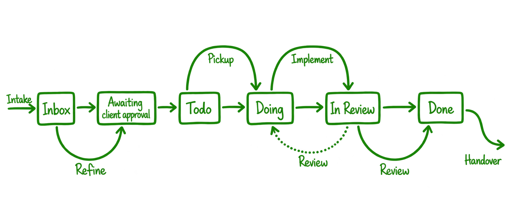

# Pinelab Engineering
Human and AI engineering principles used at Pinelab.studio

* [`docs/best-practices`](docs/best-practices) - General engineering guidelines at Pinelab that apply to all our projects.
* [`docs/recipes`](docs/recipes) - Feature specific guides that can be invoked on demand.
* [`docs/workflow`](docs/workflow) - Way of working at Pinelab, used by developers at Pinelab, but also yours to view!

# For Everyone

Anyone, including external consumers, can reference [index.md](index.md) in their AI prompts when developing features. It lists general Pinelab best practices and feature-specific recipes, so your agent can find and follow the relevant guides. For example:

```text
Implement this feature using the Pinelab Vendure best practices from: https://raw.githubusercontent.com/Pinelab-studio/pinelab-engineering/heads/main/index.md
```

# For Pinelab Developers

The Pinelab MCP exposes tools and coding standards and guidelines on how we work. The only real tool is for managing Trello cards, the rest are all skills that explain your local Codex/Pi/Opencode on how to handle tasks. 

Add the Pinelab MCP server to your harness:

```md
{
  "mcpServers": {
    "pinelab": {
      "url": "https:pinelab-engineering-mcp.worker.dev",
      "headers": {
        "Authorization": "Bearer YOUR_API_KEY"
      }
    }
  }
}
```

_:warning: Always mention 'pinelab' in your first prompt message when working on Pinelab tasks, so the correct skills are loaded via the MCP._

Skills and tools are designed to only trigger when you explicitly mention Pinelab as to not affect any of your other workflows.

These instructions are based on our kanban workflow:



Use these prompts to make your AI harness live up to Pinelab's way of working and quality standards:

## Intake 
Task intake happens automatically, no need to worry about this.

## Refine

_If a task is in "Todo" it is already refined, skip this step!_

Start refining a task by prompting something like

```text
Start refining Pinelab task <Trello task link>
```

The `pinelab-refine` skill will trigger, fetch the task, start interviewing you and moves the task to "Waiting For Client Approval".


## Implement 

Start working on a task by prompting:

```text
Start planning Pinelab task <Trello task link> 
```

This will trigger the `pinelab-plan` skill, move the card to "Doing" and start the implementation flow: It will interview you for a plan, and ask you to implement. After implementation it will ask you to create a PR.

:information_source: _You are free to use your own `/plan` prompt, just make sure to also mention Pinelab so it loads the Pinelab best practices._

## Review

**Always** review your own pull request:

```text
Please Pinelab review <link to PR>
```

This will trigger the `pinelab-code-review` flow: Read PR description and comments, checkout the branch locally and reviews the code. It will again interview you, and you can make modification during the review, and push the to the open PR.

## Handover

After a PR has been approved, you can use this prompt to start handover:

```text
Handover Pinelab task <link to PR>
```

1. Refine a task (might be done already)
2. Pick up and `/implement` a task
3. Create a Pull Request
4. Always `/review <gh PR link>` your own implementation before creating a Pull Request
5. Another developer will `/review` your Pull Request
