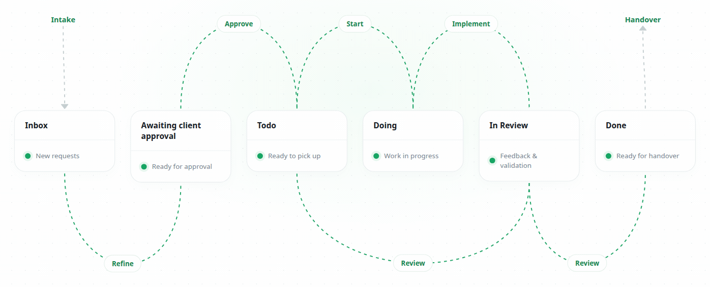

# Pinelab Engineering

Human and AI engineering principles used at Pinelab.studio. Our engineering principles consist of these 2 components:

* [`docs/best-practices`](docs/best-practices) - General engineering guidelines at Pinelab that we use in almost all day-to-day tasks.
* [`docs/recipes`](docs/recipes) - Feature specific guides that can be invoked on demand. We only include this when researching new features, before actual implementation. 
* [`docs/workflow`](docs/workflow) - Way of working at Pinelab: Our kanban flow, expected PR handover etc. Mostly internal Pinelab stuff, but use it to your advantage.
  
# For Everyone

Please see https://plugins.pinelab.studio/ai-integration/ on how to use our best practices and recipes in your AI workflow.


# For Pinelab Developers

The Pinelab MCP exposes tools and coding standards and guidelines on how we work.

See [`TOOLS.md`](./mcp/TOOLS.md) for tools and the amount of tokens the MCP adds to your context.

Add the Pinelab MCP server to your harness:

```md
{
  "mcpServers": {
    "pinelab": {
      "url": "https://mcp.pinelab-studio.workers.dev/mcp",
      "headers": {
        "Authorization": "Bearer YOUR_API_KEY"
      }
    }
  }
}
```

These instructions in this MCP are based on our kanban workflow:



## What is expect of you

Use these prompts to live up to Pinelab's way of working and quality standards:

* **Intake** - happens automatically, nothing to do here. 
* **Refine** - Not needed for tasks in **Todo**. If you want to refine, prompt: `Refine Pinelab card <Trello card link>` or `Refine this for Pinelab: <description of the work>`
* **Implement** - `Implement Pinelab card <Trello card link>`
* **Self review** - :warning: Always review your own PR before asking someone else to review: `Please Pinelab review <link to PR>`
