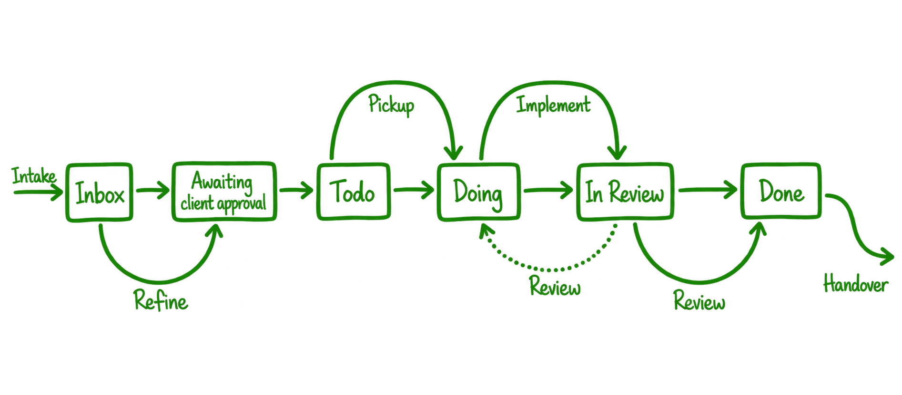

# Pinelab Engineering

Human and AI engineering principles used at Pinelab.studio. Our engineering principles consist of these 2 components:

* [`docs/best-practices`](docs/best-practices) - General engineering guidelines at Pinelab that we use in almost all day-to-day tasks.
* [`docs/recipes`](docs/recipes) - Feature specific guides that can be invoked on demand. We only include this when researching new features, before actual implementation. 
* [`docs/workflow`](docs/workflow) - Way of working at Pinelab: Our kanban flow, expected PR handover etc. Mostly internal Pinelab stuff, but use it to your advantage.
  
# For Everyone

Please see https://plugins.pinelab.studio/ai-integration/ on how to use our best practices and recipes in your AI workflow.


# For Pinelab Developers

The Pinelab MCP exposes tools and coding standards and guidelines on how we work. The only real tool is for managing Trello cards, the rest are all skills that explain your local Codex/Pi/Opencode on how to handle tasks.
We care about your context, so we keep the toolset and descriptions short. See [`TOOLS.md`](./mcp/TOOLS.md) the amount of tokens the MCP adds to your context.

Add the Pinelab MCP server to your harness:

```md
{
  "mcpServers": {
    "pinelab": {
      "url": "https://mcp.pinelab-studio.workers.dev/mcp",
      "headers": {
        "Authorization": "Bearer YOUR_API_KEY"
      }
    }
  }
}
```

Workflow skills are designed to only trigger when you mention  **Pinelab** as to not affect your personal way of working.

These instructions in this MCP are based on our kanban workflow:



Use these prompts to make your AI harness live up to Pinelab's way of working and quality standards:

## 0. Intake 
Task intake happens automatically, no need to worry about this.

## 1. Refine

_If a task is in "Todo" it is already refined, skip this step!_

Refining means agreeing on the goal, functional requirements, test behaviours, and technical guidance so another developer can pick up the task. Investigate feasibility and risks; leave detailed implementation choices to `Plan and Implement` below. When refining a Trello task, the workflow fetches it, asks about unresolved decisions, and moves the confirmed task to "Waiting For Client Approval".

Start refining a task by prompting something like:

```text
Start refining Pinelab task <Trello task link>
```


## 2. Plan and Implement 

Use this when starting development on a task that is ready to pick up (in the Todo list when using Trello). Input can also be text, a document, or conversation context. Reuse any confirmed refinement, verify its technical guidance against current code, and resolve only remaining implementation and test-strategy decisions before confirming the plan. This flow includes Pinelab's best practices.

Start working on a task by prompting:

```text
Start planning Pinelab task <Trello task link> 
```


:information_source: _You may use your own `/plan` prompt or planning flow. Just make sure to mention "use Pinelab's best practices" when invoking your own plan-mode._

## 3. Review

After implementation, **Always** review your own pull request:

```text
Please Pinelab review <link to PR>
```

This will trigger the `pinelab-code-review` flow: Read PR description and comments, checkout the branch locally and reviews the code. It will again interview you, and you can make modification during the review, and push the to the open PR.

4. Handover

After a PR has been approved, you can use this prompt to start handover:

```text
Handover Pinelab task <link to PR>
```

1. Refine a task (might be done already)
2. Pick up a task using `plan-and-implement` or your own standards-compliant planning flow
3. Create a Pull Request
4. Always `/review <gh PR link>` your own implementation before creating a Pull Request
5. Another developer will `/review` your Pull Request

See [`TOOLS.md`](./mcp/TOOLS.md) for a list of the exposed MCP tools.
